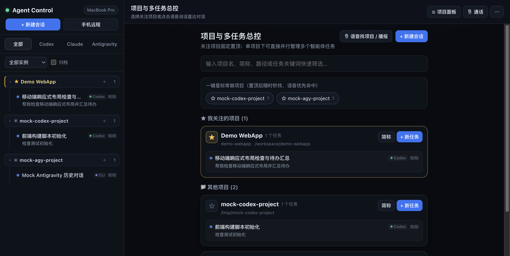
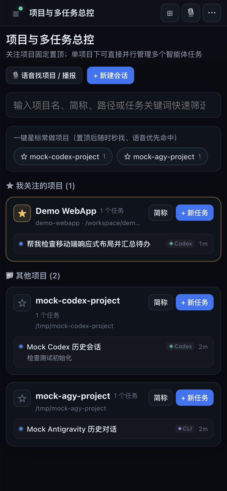
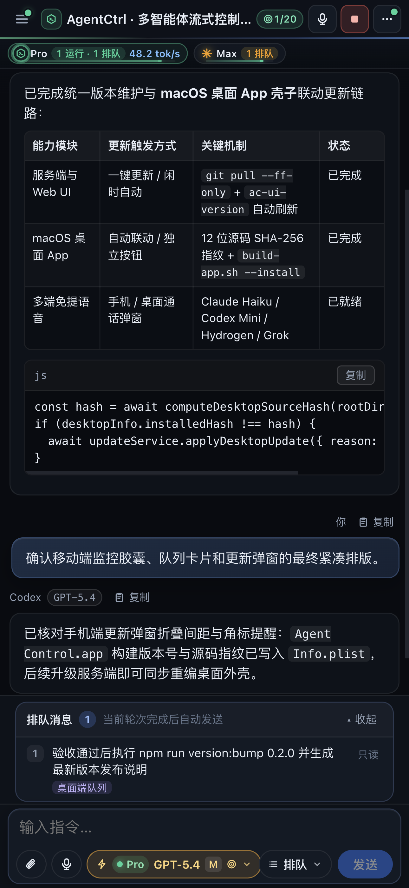

# Agent Control

> 在电脑和手机上统一看 **Codex**、**Claude Code**、**Antigravity** 和 **Grok** 的任务进度、随时续跑对话与批复权限 —— 一条命令装好即用，不改动原工具的任何配置与记录。
> 如果这个工具帮到了你，欢迎点击右上角 **Star ⭐️** 支持一下。



<details>
<summary>查看更多实拍效果（手机远程总控与对话界面）</summary>





</details>

---

## ⚡ 一行命令装好直接用

只需要本机有 **Node.js 22+** 和 **Git**（如未安装，脚本会自动提示安装命令）。

**macOS / Linux**（打开「终端」粘贴回车）：

```bash
curl -fsSL https://raw.githubusercontent.com/guuguo/agent-control/main/install.sh | bash
```

**Windows**（打开 **PowerShell** 粘贴回车）：

```powershell
irm https://raw.githubusercontent.com/guuguo/agent-control/main/install.ps1 | iex
```

---

## ✨ 装完怎么用？

1. **打开即用**：安装完成后会自动打开控制台（macOS 会在「应用程序」生成 **Agent Control** 独立桌面应用，也可浏览器打开 `http://127.0.0.1:43310`）。
2. **电脑端统一管理**：左侧按项目查看所有正在跑或历史中的智能体任务，点进去即可续发消息、切换模型、设置自动推进或批量归档。
3. **手机扫码远程看**：点页面右上角 **「手机远程」** 生成二维码，手机扫一下就能随时看输出、发指令、批权限。👉 [查看手机扫码图文教程](教程.md) · [固定链接与容器部署全指南](docs/remote-deploy.md)

### 手机远程方案怎么选？（装完随时可换）

安装时默认推荐 **Cloudflare 免费临时隧道**，同时支持以下固定链接与一键容器方案（在弹窗或命令行随时切换，不用重装）：

| 方案 | 费用 | 域名是否固定 | 适合谁 | 特点 |
| --- | --- | :---: | --- | --- |
| **Cloudflare 免费临时隧道（默认）** | **0 元** | 临时随机 | 大多数人、零门槛体验 | 免服务器、免注册账号，5 秒出二维码、关闭即焚 |
| **Tailscale Funnel** | **0 元** | **永久固定**（`*.ts.net`） | 想长期收藏到手机、不买域名/服务器 | 免费个人版即送固定 HTTPS 域名，支持在面板一键开启 |
| **Cloudflare Named Tunnel** | **0 元隧道** | **永久固定**（自定义域名） | 手头已有 Cloudflare 托管域名 | 隧道永久免费不限时，服务常驻本机 |
| **Sealos / Docker 一键中继** | **Sealos 约 ¥5～15/月** | **永久固定** | 高频日用、多设备中继、不暴露本机端口 | 断网/重启自动重连，提供一键容器脚本与 Sealos 模板 |
| **仅本机使用** | **0 元** | — | 只在电脑上使用 | 不装任何隧道组件，后续随时可切换 |

---

## 🗑️ 不想用了？一行命令卸载

**macOS / Linux：**

```bash
curl -fsSL https://raw.githubusercontent.com/guuguo/agent-control/main/uninstall.sh | bash
```

**Windows (PowerShell)：**

```powershell
irm https://raw.githubusercontent.com/guuguo/agent-control/main/uninstall.ps1 | iex
```

---

<details>
<summary>进阶用法、命令行切换、自托管部署与开发者说明（按需展开）</summary>

### 1. 命令行快捷管理（macOS / Linux）

```bash
agent-control open                # 打开桌面应用或控制台
agent-control status              # 查看服务状态
agent-control logs                # 查看服务日志
agent-control restart             # 重启后台服务
agent-control remote status       # 查看当前隧道/中继/固定链接状态
agent-control remote cloudflare   # 切换或补装 Cloudflare 免费隧道
agent-control remote tailscale    # 开启 Tailscale Funnel（0 元永久 *.ts.net）
agent-control remote relay        # 切换并绑定自托管固定中继
agent-control update              # 拉取最新版本并更新桌面端
```

### 2. 非交互指定安装参数

```bash
# 默认：Cloudflare 免费临时隧道
curl -fsSL https://raw.githubusercontent.com/guuguo/agent-control/main/install.sh | bash -s -- --remote cloudflare

# Tailscale Funnel（0 元免域名固定链接）
curl -fsSL https://raw.githubusercontent.com/guuguo/agent-control/main/install.sh | bash -s -- --remote tailscale

# 直接连接自己的中继服务器
curl -fsSL https://raw.githubusercontent.com/guuguo/agent-control/main/install.sh | bash -s -- --remote relay --relay-url https://relay.example.com --invite 你的邀请码

# 仅本机使用
curl -fsSL https://raw.githubusercontent.com/guuguo/agent-control/main/install.sh | bash -s -- --remote local
```

### 3. 一键容器部署固定中继（Sealos 约 ¥5~15/月 · Docker）

- **任意带 Docker 的服务器（一行容器脚本）**：

```bash
git clone https://github.com/guuguo/agent-control.git && cd agent-control
./deploy/one-click.sh --url https://relay.example.com
# 如无公网 80/443 入站，可加 --cf-token <CloudflareTunnelToken> 自动打通 HTTPS
```

- **Sealos 容器云（实测约 ¥5～15/月）**：
  - 图形界面 App Launchpad 直接填镜像 `ghcr.io/guuguo/agent-control-relay:latest`（端口 `8080`、挂 `128Mi` 存储到 `/data`）；
  - 或用一键脚本 `KUBECONFIG=~/.kube/sealos.yaml ./deploy/sealos/deploy.sh --host xxxx.cloud.sealos.run`。
  - 👉 完整图文步骤与环境变量说明见 [docs/remote-deploy.md](docs/remote-deploy.md)。

2. 签发一次性配对邀请码并在控制台「手机远程」或 `agent-control remote relay` 中绑定：

```bash
RELAY_PUBLIC_URL=https://relay.example.com RELAY_KEY=你的密钥 npm run invite -- "My Mac"
```

### 4. 常用环境变量与数据目录

- 所有会话通过 `<provider>:<profileId>:<rawId>` 复合 ID 只读索引，重命名/归档/置顶持久化于独立数据目录（macOS：`~/Library/Application Support/Agent Control`；Windows：`%APPDATA%\Agent Control`；Linux：`~/.local/share/agent-control`），不会修改原工具数据库。
- 常用环境变量：`PORT`（默认 `43310`）、`HOST`（默认 `127.0.0.1`）、`AGENT_CONTROL_DATA_DIR`、`AGENT_CONTROL_DISABLE_RELAY`、`AGENT_CONTROL_TITLE_RULES_FILE`、`AGENT_CONTROL_CODEX_HOMES`、`AGENT_CONTROL_CLAUDE_CONFIG_DIRS`、`AGENT_CONTROL_AGY_APP_DATA_DIRS`、`CODEX_BIN`、`CLAUDE_BIN`、`AGY_BIN`。

### 5. 本地开发与零消耗测试

```bash
git clone https://github.com/guuguo/agent-control.git
cd agent-control
npm install
npm run check
npm test
npm run desktop:install   # macOS 构建安装 /Applications/Agent Control.app
```

全部自动测试均使用 Mock CLI 模拟智能体进程，**不消耗任何真实模型 Token**。

</details>

## License

[AGPL-3.0-only](LICENSE)
