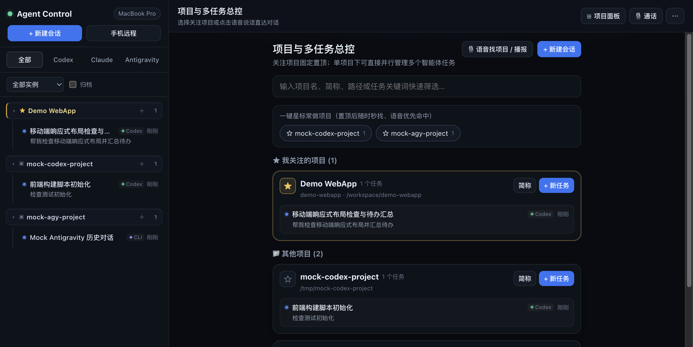
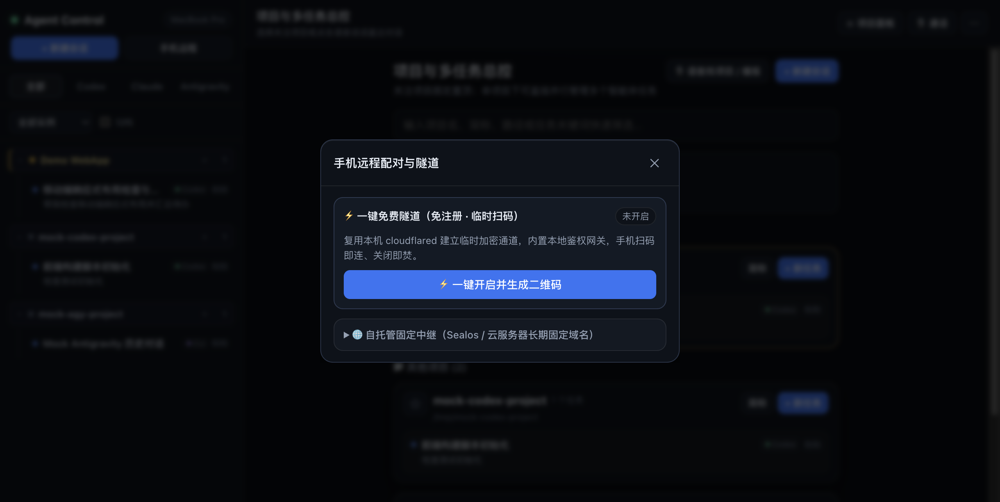
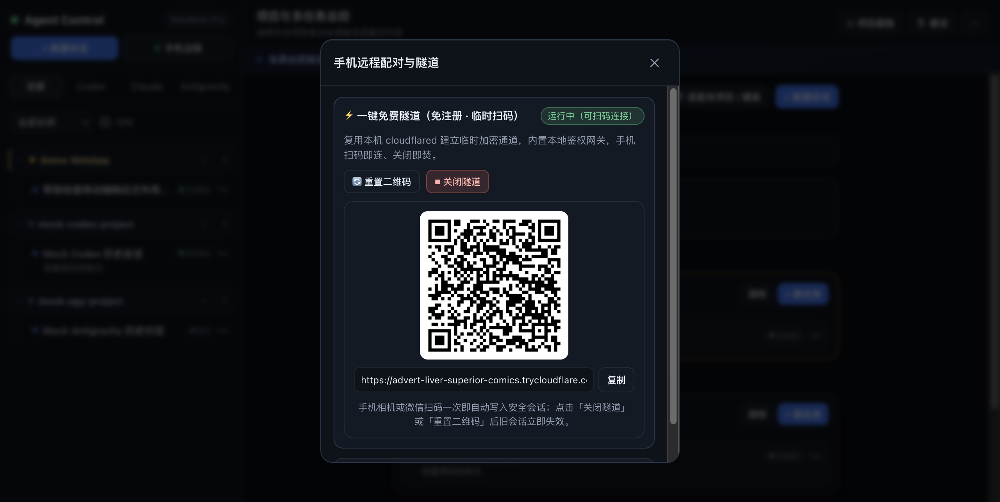
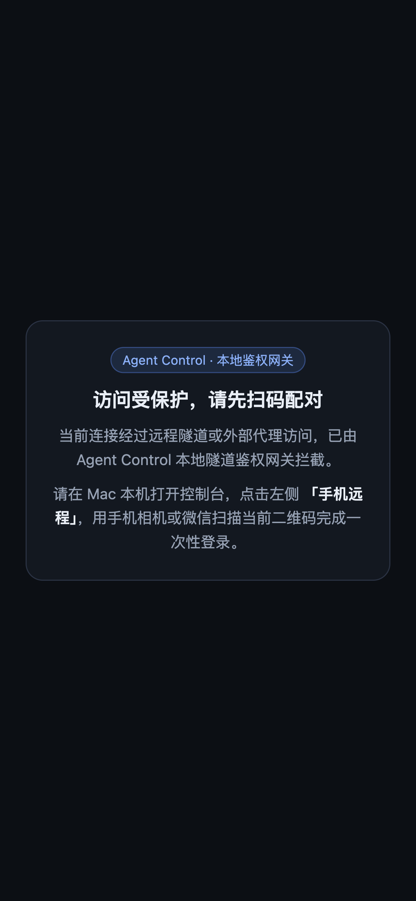
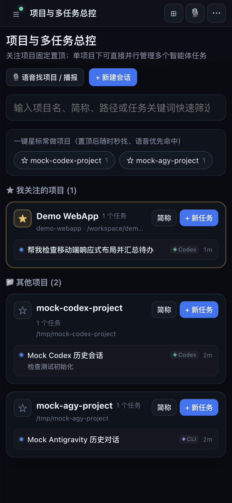
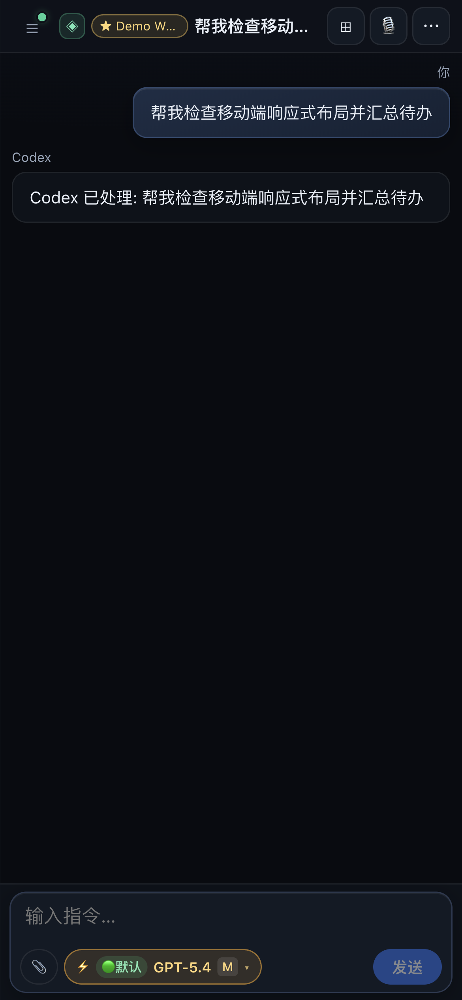
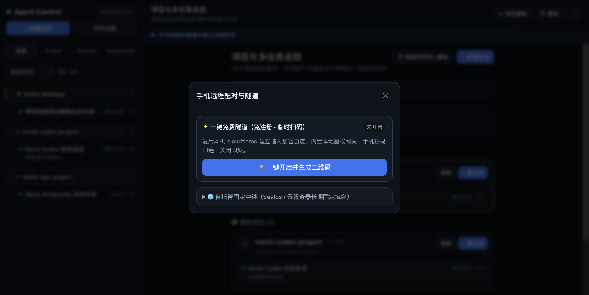

# 手机扫码远程控制教程（一键免费隧道版）

想在外面随时用手机看 Mac 上的 **Codex / Claude Code / Antigravity** 跑得怎么样、顺手回一条指令或点一下审批，但既不想自己买服务器，也不想折腾账号注册和域名绑定？

Agent Control 内置了 **一键免费隧道（Cloudflare Quick Tunnel + 本地隧道鉴权网关）**：在 Mac 控制台点一下按钮，**约 5～6 秒**即可拿到加密 HTTPS 公网地址与配对二维码，手机扫码一次就能直接操控本机控制台，用完一键关闭即可。

---

## 为什么免账号的免费隧道也能保证安全？

Cloudflare Quick Tunnel 的随机公网域名本身只是加密传输通道，为了避免“拿到随机域名就能直接打开本机控制台”，Agent Control 在本机服务端内置了一层**本地隧道鉴权网关**：

1. **公网入口默认全拦截**：只要请求来自非本机直连（或携带反向代理转发头），没有通过扫码配对的浏览器一律会被拦截在鉴权提示页，无法读取会话列表或触发任何控制接口；`/health` 也仅返回脱敏后的健康状态（不暴露实例名和内部状态）。
2. **256-bit 配对码换取安全 Cookie**：扫码打开一次性配对链接 `/connect/<token>` 后，本地网关会校验凭证并写入 `HttpOnly`、`SameSite=Lax` 的安全会话 Cookie，随后立即重定向到根路径，不在手机浏览器地址栏保留敏感 Token。
3. **高危管理仅限 Mac 本机直连**：开启隧道、关闭隧道、重置二维码，以及读取或修改中继配置，仅允许来自 Mac 本机 `127.0.0.1` / `localhost`（且不带代理头）的直连访问，手机端无法反客为主篡改隧道开关。
4. **随时重置踢人、关闭即焚**：点击「重置二维码」会立即吊销所有已配对手机的历史会话；点击「关闭隧道」不仅会销毁临时 `cloudflared` 进程和公网地址，也会同步失效所有远程登录态。

---

## 前置准备（仅首次需要）

1. **安装 `cloudflared`**（免费开源，无需登录 Cloudflare 账号）：

   ```bash
   brew install cloudflared
   ```

2. **在本机启动 Agent Control**：

   ```bash
   # 前台启动
   npm start

   # 或者注册为 macOS 后台常驻服务
   ./scripts/local-control.sh install
   ```

3. 在 Mac 浏览器打开本机地址 [`http://127.0.0.1:43310`](http://127.0.0.1:43310)（本机直连默认免扫码）。

---

## 5 步快速上手

### 第 1 步：打开控制台，点击「手机远程」

在 Mac 桌面端打开控制台后，点击左侧边栏顶部的 **「手机远程」** 按钮，弹出 **「手机远程配对与隧道」** 窗口。首次打开时，上方 **「一键免费隧道（免注册 · 临时扫码）」** 状态为 `未开启`。





---

### 第 2 步：点击「一键开启并生成二维码」

点击蓝色按钮 **「⚡ 一键开启并生成二维码」**，Agent Control 会自动拉起本机 `cloudflared` 建立临时加密隧道，并等待边缘节点注册就绪（实测约 **5～6 秒**）。

就绪后，状态徽标会变为绿色的 **`运行中（可扫码连接）`**，面板中间直接展示本次专属配对二维码以及对应的公网链接。



---

### 第 3 步：用手机扫码配对登录

直接用手机**系统相机**（推荐）或微信扫一扫页面上的二维码即可完成一次性配对。

为直观对比本地隧道鉴权网关的效果，下面分别展示**「未扫码直接打开公网链接」**与**「扫码配对后进入控制台」**的实测画面：

| 未扫码直接访问公网 URL（被鉴权网关拦截） | 扫码配对后（自动进入移动端项目总控） |
| :---: | :---: |
|  |  |

> **小贴士**：手机浏览器会自动在移动端视图下切换到适配小屏的卡片总控，单手就能浏览关注项目与各个任务的最新状态。

---

### 第 4 步：在手机上查看项目进度与远程对话

点击任意任务即可直接进入会话详情页。你可以随时查看 Codex / Claude Code / Antigravity 的历史与实时流式输出，也可以通过底部输入框继续发送新指令、切换模型或权限模式。



---

### 第 5 步：重置踢人，或用完一键关闭隧道

- 如果二维码不小心泄露，或想踢掉已连接的其他手机：点击 **「重置二维码」**，系统会立刻生成新配对码，旧手机刷新即重新被网关拦截。
- 回到电脑前或临时外出结束：点击红色的 **「关闭隧道」**，后台 `cloudflared` 进程立即终止、临时公网域名失效、所有远程会话同步销毁，页面恢复到未开启状态。



---

## 方案对比：一键免费隧道 vs 自托管固定中继

弹窗底部折叠收起了 **「自托管固定中继（Sealos / 云服务器长期固定域名）」**，两种方案可以按场景随时切换：

| 对比维度 | 一键免费隧道（Quick Tunnel） | 自托管固定中继（Relay） |
| :--- | :--- | :--- |
| **适用场景** | 临时外出、偶尔手机看进度/发几条指令、开源新人零门槛体验 | 每天高频使用、收藏到手机桌面、不想每次重新扫码 |
| **准备成本** | 仅本机一条 `brew install cloudflared`，免账号免服务器 | 需要一台云服务器或 Sealos 等容器托管中继并绑定域名 |
| **域名特征** | 每次开启生成临时随机 `*.trycloudflare.com` 域名 | 长期固定域名（如 `https://agent.example.com`） |
| **安全机制** | 本地网关鉴权 + 256-bit 一次性扫码配对 + 关闭/重置即吊销 | 主机出站 WS 隧道 + 配对 Token + 控制端凭证校验 |

---

## 常见问题（FAQ）

### 1. Mac 上开着 Clash / Surge / TUN 代理模式，会不会出现 Cloudflare Error 1033？

会，原生 `cloudflared` 默认优先尝试 QUIC（UDP）协议；在部分 TUN / Fake-IP（如 `198.18.x.x`）网络环境下，虽然预检可能看似通过，但实际 QUIC 握手会长期挂起，从而导致页面报错 `Error 1033`。

Agent Control 已针对该场景做过实测与内置规避：拉起 `cloudflared` 时**默认使用 `--protocol http2`（基于 TCP）并跳过冗余预检**，同时必须等待日志确认边缘连接注册完成（`Registered tunnel connection`）后才显示二维码，确保亮码即可直接访问。

如果某些特殊网络确实需要改回自动协议探测，可以在启动时覆盖环境变量：

```bash
AGENT_CONTROL_CLOUDFLARED_PROTOCOL=auto npm start
```

### 2. 用系统相机扫好，还是微信扫好？

优先推荐 **iPhone / Android 系统自带相机** 扫一扫，直接跳系统浏览器打开。因为安全会话 Cookie 绑定在打开配对链接的当前浏览器内核中；如果先用微信内置浏览器扫码配对，再点「在 Safari/外部浏览器中打开」，由于两者 Cookie 不互通，外部浏览器需要重新扫一次二维码。

### 3. 人离开电脑后，Mac 息屏锁屏导致断网怎么办？

macOS 默认合盖或长时间不操作会进入休眠并断开网络与隧道进程。出门前建议在终端执行一条系统防休眠命令（回到电脑后按 `Ctrl+C` 恢复即可）：

```bash
caffeinate -dimsu
```
